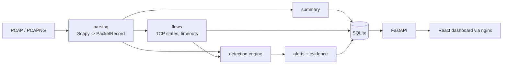

# NetSentinel

**Network traffic analysis and intrusion detection platform** (personal portfolio project).

NetSentinel reads packet captures (PCAP / PCAPNG), rebuilds the connections inside them,
and runs its own detection rules to point an analyst at suspicious patterns (port scans, traffic
floods, repeated failed connections), with the evidence behind every alert. Results are stored in
SQLite and shown in a web dashboard. It is built and tested to run in hardened containers, with a
CI pipeline that lints, tests and scans everything on each push.


> Alerts are **indicators, not proof** of an attack, and no alert is not proof of safety.
> Everything below is implemented and tested; measured numbers are in [docs/results.md](docs/results.md).

## What it does

| Area | What | Details |
|---|---|---|
| Parsing | Streams PCAP/PCAPNG: protocols, IPs, ports, sizes, TCP flags, DNS names | [architecture](docs/architecture.md) |
| Flows | Groups packets into bidirectional flows with TCP states (established, rejected, no reply, half-open...), idle timeouts, rates | [flows](docs/flows.md) |
| Detection | 3 rules, thresholds in a TOML file, MITRE ATT&CK hint and evidence per alert: **NS-001** port scan (T1046), **NS-002** unsolicited traffic spike (T1498), **NS-003** repeated failed connections (T1110 / misconfiguration) | [detection](docs/detection.md) |
| Validation | 14 labelled scenarios + `evaluate` command: scores each alert on the right rule **and** the right source host | [results](docs/results.md) |
| API | FastAPI + SQLite: upload, analyses, flows, alerts, rules; uploads checked by size, extension and file signature | [api](docs/api.md) |
| Dashboard | React + TypeScript: overview, traffic/flows, alerts with evidence, upload | [dashboard](docs/dashboard.md) |
| Operations | Docker Compose (non-root, read-only, no capabilities, localhost only), JSON logs with request IDs, health checks | [deployment](docs/deployment.md) |
| Cloud | Private Cloud Run service on Google Cloud, created with Terraform (least-privilege service accounts, no public access), deployed by GitHub Actions through Workload Identity Federation (no keys), Cloud Monitoring dashboard + 5xx alert | [GCP deployment](docs/gcp-deployment.md) |
| CI | GitHub Actions: ruff, 99 pytest tests on Python 3.13 + 3.15, frontend typecheck/tests/build/audit, Trivy on code and both images, end-to-end upload through the containers; Dependabot | [CI](docs/deployment.md#ci-github-actions-githubworkflowsciyml) |

## Results (measured 2026-11-23)

- **Labelled scenarios:** 14 / 14 behaved as predicted, including the predicted limits.
  NS-001 noticed 3 / 5 scans (misses slow and horizontal scans) with 1 false alarm (a
  monitoring server); NS-002 2 / 3 floods (misses one spread over 20 sources); NS-003 2 / 2.
  These scenarios were written together with the rules: they check design, not real-world
  accuracy.
- **Real captures from my own lab:** a loopback scan of 200 ports -> NS-001 high (199 ports in
  4.6 s); 15 connections to a closed port -> NS-003; 3 captures of normal use (87 000+ packets)
  -> 0 alerts.
- **Speed:** ~5 000 packets/s on one laptop core, linear up to 1 million packets (219 s, 228 MB
  peak memory). ~81 % of the time is Scapy's packet decoding, ~5 % NetSentinel's own code.
- **Bugs found by testing, not by users:** a Windows TCP retry counted as a second connection;
  a false traffic-spike alert on a QUIC download; upload names keeping `..\` folders on Linux
  (found by the first CI run); two scans far apart merged into one alert (found by the benchmark).
  Each is fixed with a regression test and written up in the docs.

## Quick start

With Docker (dashboard on http://localhost:8080, API docs on http://localhost:8000/docs):

```powershell
docker compose up --build
```

Without Docker (Windows, PowerShell, Python 3.12+):

```powershell
py -3.13 -m venv .venv
.\.venv\Scripts\Activate.ps1
python -m pip install -e ".[dev]"
pytest
netsentinel analyze path\to\capture.pcapng --top 10 --json report.json
netsentinel make-scenarios scenarios_out     # labelled synthetic captures, nothing is sent
netsentinel evaluate scenarios_out           # TP / FP / FN per rule
netsentinel serve                            # REST API on http://127.0.0.1:8000
```

Dashboard in development (second terminal, Node.js): `cd frontend`, `npm install`, `npm run dev`.

A 5-minute demo walkthrough is in [docs/demo.md](docs/demo.md).

On Google Cloud (private, only allowed Google accounts): see
[docs/gcp-deployment.md](docs/gcp-deployment.md) for Terraform, the deploy workflow, access
through `gcloud run services proxy`, cost (free tier) and `terraform destroy`.

## Architecture



One pass over the file feeds every analyzer. Only `parsing` (and the scenario generator)
import Scapy; everything else works on plain `PacketRecord` objects. More in
[docs/architecture.md](docs/architecture.md).

## Limits

- Offline analysis of captures, not a live sensor; ~5 000 packets/s is far from a busy link.
- Metadata only: no payload inspection, nothing inside TLS, no host logs, so no detection of
  brute force against an open service.
- Rules miss slow, horizontal and distributed attacks (measured above) and fire on monitoring tools.
- No authentication or TLS in the app itself: locally the containers only listen on 127.0.0.1;
  on Cloud Run, Google IAM checks every request before it reaches the app.
- On Cloud Run the SQLite database is in memory and is lost when the service scales to zero.
- Detection was not tested on public labelled datasets (e.g. CIC-IDS2017): next step.

## Safety and scope

All traffic analysed was captured on my own machine and home network, or generated
synthetically with documentation-only addresses (RFC 5737). The only "attack" script
(`lab/scenarios/loopback_test.py`) is hard-coded to 127.0.0.1. Captures are git-ignored because
they can contain private data. NetSentinel has no offensive features.

## Own code vs. dependencies

All analysis, flow, detection and evaluation logic in `src/netsentinel/` and the dashboard in
`frontend/src/` are written for this project. Libraries: Scapy (packet decoding), FastAPI +
Uvicorn (API), React + Vite (dashboard), pytest, Vitest, ruff (tooling), psutil (benchmark only).

## Status

Phases 0-8 are done; Phase 9 adds the Google Cloud deployment. See [PROJECT_STATUS.md](PROJECT_STATUS.md) for the log.

## License

[MIT](LICENSE)
