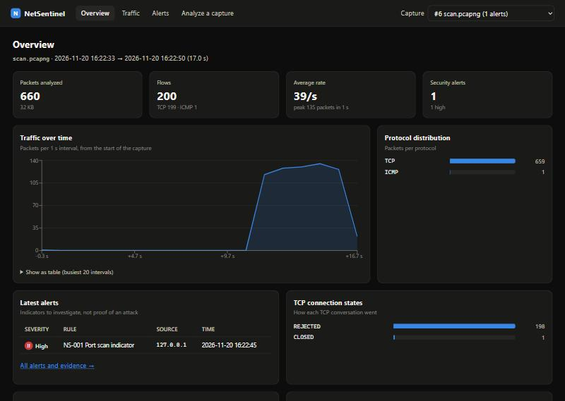

# NetSentinel

**Network Traffic Analysis & Intrusion Detection Platform** (personal portfolio project)

> Status: **Phase 7 in progress** (PCAP analysis, flows, 3 detection rules, REST API + SQLite,
> React dashboard, structured logs; Docker + CI written, not yet run).


> This README is updated only with features that exist and are tested.

## Problem

Network traffic shows who talks to whom, how often and on which ports. Patterns in that
metadata (a host touching hundreds of ports in seconds, a burst of refused connections) are
early indicators of reconnaissance or misconfiguration. NetSentinel reads packet captures,
groups packets into flows, and applies its own detection rules to surface those indicators,
with the evidence behind each alert.

Detection rules produce **suspicious indicators, not proof of malicious activity**.

## Planned capabilities

| Capability | Phase | Status |
|---|---|---|
| PCAP parsing: protocols, IPs, ports, sizes, DNS | 2 | done, tested |
| Flow aggregation, TCP states, traffic rates ([how](docs/flows.md)) | 3 | done, tested |
| Rule engine: port scan, traffic spike, failed connections ([rules, limits, results](docs/detection.md)) | 4 | done, tested |
| SQLite storage + FastAPI REST API ([endpoints, input checks](docs/api.md)) | 5 | done, tested |
| React + TypeScript dashboard ([pages, run, screenshots](docs/dashboard.md)) | 6 | done, tested |
| Structured JSON logs with request IDs ([logging](docs/deployment.md#structured-logs)) | 7 | done, tested |
| Docker Compose, GitHub Actions CI, Trivy ([deployment](docs/deployment.md)) | 7 | written, not yet run |
| Lab scenarios with measured results | 8 | planned |

Architecture: see [docs/architecture.md](docs/architecture.md).

## Development setup (Windows, PowerShell)

Requires Python 3.12+ and Git.

```powershell
cd D:\projects\netsentinel
py -3.13 -m venv .venv
.\.venv\Scripts\Activate.ps1
python -m pip install -e ".[dev]"
pytest
ruff check .
netsentinel --version
netsentinel analyze path\to\capture.pcapng --top 10 --json report.json
netsentinel analyze capture.pcapng --rules config\rules.example.toml
netsentinel make-scenarios scenarios_out
netsentinel evaluate scenarios_out
netsentinel serve        # REST API on http://127.0.0.1:8000, docs at /docs
```

Dashboard (second terminal, needs Node.js):

```powershell
cd frontend
npm install
npm run dev              # http://localhost:5173
```

With Docker instead (dashboard on http://localhost:8080, details in
[docs/deployment.md](docs/deployment.md)):

```powershell
docker compose up --build
```

Conventions and lab safety rules: [docs/conventions.md](docs/conventions.md).

## Own code vs. dependencies

All analysis, flow and detection logic in `src/netsentinel/` is written for this project.
Third-party libraries (listed in `pyproject.toml`) are used for packet decoding, the web API
and tooling; each is named in this README when it is introduced.

## License

To be decided before the repository is made public.
