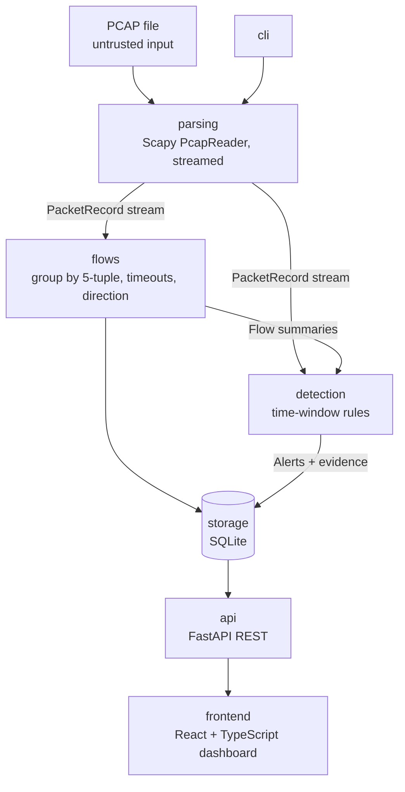

# Architecture

NetSentinel is **one Python package with clear internal modules**, not a set of services.
Each stage only depends on the output of the stage before it, so each can be tested alone.



## Key design decisions

1. **`PacketRecord` boundary.** `parsing` converts each Scapy packet into a small plain record
   (timestamp, src/dst IP, src/dst port, protocol, TCP flags, length, DNS fields). Nothing after
   `parsing` imports Scapy. Tests can build records by hand, and the decoder could be replaced
   (e.g. by `dpkt` for speed) without touching flows or detection.
2. **Streaming.** Packets are read one at a time (`PcapReader`), never all loaded into memory.
3. **Synchronous first.** Analysis runs inside the request/CLI call, with a file-size limit.
   A background worker is added only if measurements show it is needed.
4. **Configurable thresholds.** Rule thresholds live in configuration, not in code.

## Planned layout

```
src/netsentinel/
  parsing/     PCAP -> PacketRecord            (Phase 2)
  flows/       PacketRecord -> Flow            (Phase 3)
  detection/   rules, alert model              (Phase 4)
  storage/     SQLite persistence              (Phase 5)
  api/         FastAPI app                     (Phase 5)
  cli.py       command-line entry point        (Phase 0, exists)
tests/
  unit/  integration/  fixtures/
frontend/      React + TS                      (Phase 6)
lab/           network experiments + notes     (Phases 1, 8)
docs/          architecture, rules, decisions
```

Folders are created in the phase that needs them.
