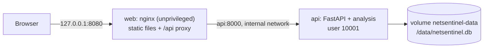

# Deployment, CI and logging

## Run everything with Docker

```powershell
copy .env.example .env      # optional, every value has a default
docker compose up --build   # first build takes a few minutes
```

- Dashboard: http://localhost:8080 (nginx serves the React build and forwards `/api` to the API)
- API docs: http://localhost:8000/docs
- Stop: `Ctrl+C`, then `docker compose down`. Add `-v` to also delete the database volume.



| Choice | Why |
|---|---|
| Two images (`Dockerfile`, `docker/web.Dockerfile`), multi-stage | runtime images contain no compiler, no Node, no source tree |
| Non-root users (API uid 10001, nginx-unprivileged on 8080) | a parsing bug in a hostile capture must not give root |
| `read_only: true` + `tmpfs: /tmp`, `cap_drop: ALL`, `no-new-privileges` | the containers cannot change their own files or gain privileges |
| Ports published on `127.0.0.1` only | no authentication yet, so not reachable from the LAN |
| Same origin through nginx | no CORS needed in production (`NETSENTINEL_CORS_ORIGINS` empty) |
| Health checks: API `/api/health` (runs a DB query), nginx `/healthz` | `depends_on: service_healthy` starts nginx only once the API answers |
| Allow-list `.dockerignore` | captures (`lab/`), databases and `.env` can never end up in an image |
| Upload limit enforced 3 times | nginx `client_max_body_size 51m`, API `Content-Length` check, size counted while saving |

If you raise `NETSENTINEL_MAX_UPLOAD_MB`, raise `client_max_body_size` in `docker/nginx.conf` too.

## Configuration (environment variables)

| Variable | Default | Meaning |
|---|---|---|
| `NETSENTINEL_DB_PATH` | `data/netsentinel.db` (`/data/...` in the image) | SQLite file |
| `NETSENTINEL_UPLOAD_DIR` | `data/uploads` | temporary uploads, deleted after analysis |
| `NETSENTINEL_MAX_UPLOAD_MB` | `50` | upload size limit |
| `NETSENTINEL_RULES_FILE` | none | TOML overriding detection thresholds |
| `NETSENTINEL_CORS_ORIGINS` | `http://localhost:5173` | comma-separated, for the dev server |
| `NETSENTINEL_LOG_LEVEL` | `INFO` | `DEBUG` also logs health checks |
| `NETSENTINEL_LOG_FORMAT` | `json` | `text` for a human-readable terminal |

Invalid values stop the server at startup with a clear error, not at the first request.

## Structured logs

One JSON object per line on stdout (`netsentinel.logging_setup`). Uvicorn's own messages go
through the same formatter. Every HTTP request gets one line with a request ID:

```json
{"time": "2026-11-22T23:29:06.204+00:00", "level": "INFO", "logger": "netsentinel.http", "message": "GET /api/analyses/99 404 2.3 ms", "request_id": "3eda64027ec64909", "method": "GET", "path": "/api/analyses/99", "status": 404, "duration_ms": 2.3}
```

(real line from `netsentinel serve` on 2026-11-22). The ID is returned in the `X-Request-ID`
response header. Behind nginx, nginx's own `$request_id` is forwarded, so one request can be
followed through both logs. Incoming IDs are only kept if they match `[A-Za-z0-9._-]{1,64}`,
so a client cannot inject fake log lines. Captures are never logged, only their SHA-256 prefix.

Read them: `docker compose logs api`, or filter with `jq`, e.g.
`docker compose logs --no-log-prefix api | jq 'select(.status >= 400)'`.

## CI (GitHub Actions, `.github/workflows/ci.yml`)

| Job | Steps |
|---|---|
| backend | `ruff check`, `ruff format --check`, `pytest`, on Python 3.13 (local venv) and 3.15 (Docker image) |
| frontend | `npm ci`, typecheck, Vitest, production build, `npm audit --omit=dev --audit-level=high` |
| security (after both) | Trivy on the repository (dependencies, secrets, Dockerfile/compose misconfigurations); build both images; Trivy on each image; `docker compose up --wait`, then a real upload through nginx of a generated synthetic port scan, which must return the NS-001 high alert |

First green run on GitHub: 2026-11-23, 2 min 31 s in total (backend 44 s, frontend 27 s,
containers + Trivy 1 min 42 s). The run before it failed on a real bug that only shows on
Linux (upload names with `\` kept their folders), which the Windows test run could not see.

Trivy fails the build on **fixable** HIGH/CRITICAL findings (`ignore-unfixed`: a vulnerability
with no patched version yet would block every build without anything to do about it).

Supply chain: the workflow has read-only permissions, and every action is pinned to a full
commit SHA (tags can be moved; the `trivy-action` tags were hijacked in March 2026). Dependabot
(`.github/dependabot.yml`) proposes weekly updates for pip, npm, base images and actions.

## Not done / limits

- No authentication or TLS: local use only. Exposing it beyond `127.0.0.1` would need both
  (for example TLS on nginx + an auth proxy).
- Base images use moving tags (`python:3.15-slim`, `node:26-alpine`,
  `nginxinc/nginx-unprivileged:mainline-alpine`); pinning by digest would make builds fully
  reproducible. Both runtime stages also apply OS security updates at build time, so an image
  built today can differ from one built next month: Trivy in CI checks each build.
- The first start of the API container can be slow on a busy laptop (3.5 min measured once,
  ~2 s normally), hence the 180 s health-check start period.

## Verified locally on 2026-11-23

Docker Desktop 20.10.22 on Windows 11:

| Check | Result |
|---|---|
| `docker compose up --wait` from an empty volume | both containers healthy after 43 s |
| Synthetic port scan uploaded through nginx | 414 packets, 200 flows, NS-001 high |
| Real lab capture `scan.pcapng` uploaded through nginx | 201 in 1.4 s, NS-001 high |
| 60 MB upload | 413 |
| Write to `/usr` in the API container / to `/data` | refused (read-only) / allowed |
| `docker compose restart api` | analyses still there (volume) |
| Dashboard on http://localhost:8080 | all data shown, no console errors (CSP OK) |
| Trivy 0.76.2, fixable HIGH/CRITICAL: repository / API image / web image | 0 / 0 / 0 |

What Trivy found before the fixes: API image 6 (zlib in Debian; urllib3, msgpack, setuptools
bundled inside pip) and web image 20 (nginx 1.30.6, musl, zlib, curl, ...). Fixes: OS
upgrades at build time, pip removed from the runtime image (not needed to run), nginx
`mainline-alpine` (1.31.7). Trivy 0.76 needs a newer Docker API than 20.10, so the local
scans used `docker save` tar files (`trivy image --input`); on GitHub's runner it reads
the images directly.
- Analysis runs inside the request (a 50 MB capture can take a minute); a job queue would be
  the next step for bigger files.
