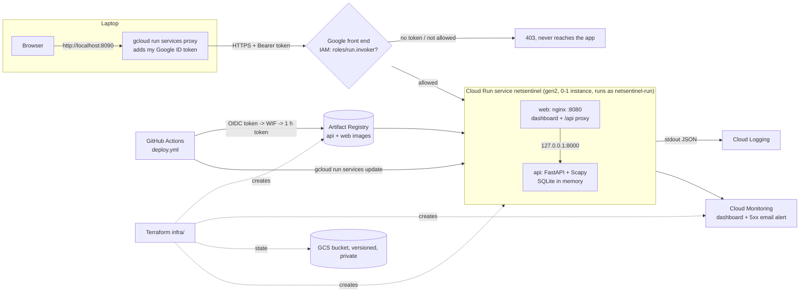

# Google Cloud deployment (Cloud Run + Terraform)

NetSentinel also runs on Google Cloud, as a **private** Cloud Run service created with Terraform
and updated by GitHub Actions without any stored key. Local use with `docker compose` is
unchanged ([deployment.md](deployment.md)).

Everything in the "Verified" section was checked on 2026-11-23/24. Project ID, account and alert
email are kept out of this repository (`infra/terraform.tfvars`, `infra/backend.hcl`, both
git-ignored); placeholders are used below.

## Architecture



**One service, two containers.** The same two images as `docker compose` run as one Cloud Run
service. Containers of one service share `localhost` (like a Kubernetes pod), so nginx reaches
the API on `127.0.0.1:8000`. The web image contains a second nginx config generated from
`docker/nginx.conf` at build time (only the upstream address differs). Cloud Run starts nginx
with `-c /etc/nginx/nginx-cloudrun.conf`; compose keeps the default. Why one service rather
than two: one private URL and one access rule, same origin (no CORS, CSP unchanged), and nginx
needs no identity of its own to call a private API.

## What Terraform creates (`infra/`)

| File | Resources |
|---|---|
| `main.tf` | 8 APIs; Artifact Registry Docker repo (cleanup: keep the 3 newest versions); service accounts `netsentinel-run` (runtime) and `netsentinel-deployer` (CI); deployer may push to this repo only and act as the runtime account only; the default compute account loses its Editor role |
| `cloudrun.tf` | Cloud Run v2 service (2 containers, gen2, min 0 / max 1 instance, 300 s timeout, 30 MB uploads, startup probes); `roles/run.invoker` for the listed accounts only (Terraform refuses `allUsers`) |
| `wif.tf` | Workload Identity Federation pool + GitHub OIDC provider; the deployer may roll out revisions of this service and call it once for the smoke test |
| `monitoring.tf` | email channel, alert policy on 5xx responses, dashboard (requests by class, latency p50/p95, memory per container, instances, warning/error logs) |
| `versions.tf` | provider versions; state in a GCS bucket (versioned, uniform access, public access prevention) |

## Security choices

| Choice | Why |
|---|---|
| No public access: only accounts with `run.invoker` | Google rejects other requests with 403 before they reach nginx or the API. The app has no login of its own, so it must not be reachable by anyone else. |
| Access through `gcloud run services proxy` | The proxy on the laptop adds a short-lived ID token to each request. A team would use IAP instead (needs a load balancer, ~18 $/month). |
| Runtime account with no roles | The containers call no Google API; logs and metrics are collected by Cloud Run itself. A compromised container gets nothing in the project. |
| Default compute account: Editor removed and account disabled | Google creates it with Editor (almost full control of the project). Nothing uses it, so it must not be an easy fallback. |
| Deployer scoped to one repository and one service | It can push images to `netsentinel` only, update and call `netsentinel` only, and act as `netsentinel-run` only. |
| Workload Identity Federation, no JSON key | GitHub's OIDC token is exchanged for a 1-hour token. Google accepts only this repository (name **and** numeric owner ID) and only `refs/heads/main`. Pull requests, forks and other branches get no token. |
| Deploy only after a green CI run on main, from the exact commit CI tested | Same tests and Trivy checks as before; the workflow also rescans the images it pushes and fails on fixable HIGH/CRITICAL. |
| Actions pinned to commit SHAs, `permissions: contents: read, id-token: write` | Same supply-chain rule as `ci.yml`. |
| Terraform state in a private, versioned bucket | It contains resource names and IDs; it is never committed. |
| gen2 execution environment | See "Bugs found" below. |

## Deploy from zero

Prerequisites: a GCP project with billing, a budget alert (created by hand in the console), the
gcloud CLI, Terraform >= 1.9, Docker.

```powershell
# 1. Own gcloud config folder (keeps this login apart from any other gcloud account)
$env:CLOUDSDK_CONFIG = "D:\projects\gcloud-netsentinel"
gcloud auth login
gcloud config set project <PROJECT_ID>

# 2. State bucket (once)
gcloud storage buckets create gs://<PROJECT_ID>-tfstate --location=europe-west1 `
  --uniform-bucket-level-access --public-access-prevention
gcloud storage buckets update gs://<PROJECT_ID>-tfstate --versioning

# 3. Terraform: copy the examples, fill them in
cd infra
copy terraform.tfvars.example terraform.tfvars
copy backend.hcl.example backend.hcl
$env:GOOGLE_OAUTH_ACCESS_TOKEN = gcloud auth print-access-token   # valid 1 hour
terraform init -backend-config=backend.hcl
terraform apply                       # image_tag = "" : registry, accounts, WIF only

# 4. First images (later ones come from GitHub Actions)
$r = terraform output -raw image_repository
gcloud auth print-access-token | docker login -u oauth2accesstoken --password-stdin https://europe-west1-docker.pkg.dev
docker build -t "$r/api:manual-1" ..
docker build -f ../docker/web.Dockerfile -t "$r/web:manual-1" ..
docker push "$r/api:manual-1"; docker push "$r/web:manual-1"

# 5. Cloud Run, invoker, monitoring
# set image_tag = "manual-1" in terraform.tfvars, then:
terraform apply
```

Terraform uses a short-lived access token from that gcloud folder (`GOOGLE_OAUTH_ACCESS_TOKEN`),
so no application-default credentials file is needed.

### Automatic deploys (`.github/workflows/deploy.yml`)

Set these **repository variables** (Settings -> Secrets and variables -> Actions -> Variables)
to the values of `terraform output github_variables`: `GCP_PROJECT_ID`, `GCP_REGION`,
`GCP_WIF_PROVIDER`, `GCP_DEPLOYER_SA`, `GCP_ARTIFACT_REGISTRY`. They are identifiers, not
secrets. Until they exist, the workflow skips itself.

After each green CI run on main (or a manual run from main), the workflow:
1. checks out the commit CI tested;
2. gets a 1-hour Google token through Workload Identity Federation;
3. builds both images, tagged with the commit;
4. scans them with Trivy (fails on fixable HIGH/CRITICAL);
5. pushes them;
6. runs `gcloud run services update` (new revision, same settings);
7. smoke test: no token gets 403, health check with an ID token, upload of a generated synthetic
   port scan must return 1 alert.

Terraform ignores the image fields after the first deploy, so a later `terraform apply` does not
roll back what CI deployed.

## Use it

```powershell
$env:CLOUDSDK_CONFIG = "D:\projects\gcloud-netsentinel"
gcloud run services proxy netsentinel --region europe-west1 --port 8090
```

Open http://localhost:8090, stop with Ctrl+C. (The proxy needs the `cloud-run-proxy` gcloud
component: `gcloud components install cloud-run-proxy`, from an administrator prompt when gcloud
is installed under Program Files.)

To give someone else access, add `user:their@email` to `invoker_members` and apply.

## Logs and monitoring

- API logs are JSON on stdout; Cloud Logging parses them into fields. Each line also carries
  `severity` (added for this deployment) so the console shows levels and can filter
  `severity>=WARNING`. Example query in Logs Explorer:
  `resource.type="cloud_run_revision" AND resource.labels.service_name="netsentinel" AND jsonPayload.status>=400`
- Dashboard **NetSentinel - Cloud Run** (Monitoring -> Dashboards).
- Alert **NetSentinel: server errors (5xx)** emails the address in `alert_email` on the first 5xx
  in a 5-minute window and closes by itself 30 minutes after errors stop.

## Cost

Measured target: 0 € per month. Free tier per billing account and month (europe-west1):
Cloud Run 180,000 vCPU-seconds, 360,000 GiB-seconds and 2 million requests; Artifact Registry
0.5 GB (two image versions are about 0.2 GB, the cleanup policy keeps 3); Cloud Logging 50 GiB.
The state bucket holds a few KB. Alerting is free until at least 2027-09-01, then about
$0.35/month for this one condition. Cloud Run scales to zero, so an idle service costs nothing.
CPU is billed only while a request is handled (`cpu_idle = true`).

A budget alert warns by email, it does not stop spending. To stop everything:

```powershell
cd infra
$env:CLOUDSDK_CONFIG = "D:\projects\gcloud-netsentinel"
$env:GOOGLE_OAUTH_ACCESS_TOKEN = gcloud auth print-access-token
terraform destroy
```

This deletes the service, images, accounts, WIF, alert and dashboard (the APIs stay enabled,
which is free). The state bucket was created by hand: delete it last with
`gcloud storage rm -r gs://<PROJECT_ID>-tfstate`, or shut down the whole project in the console.

## Limits

- **Data does not survive.** SQLite lives in the instance's in-memory filesystem: when Cloud Run
  scales to zero (about 15 minutes without requests) or deploys a new revision, analyses are
  gone. Max 1 instance so all requests see the same database. Fine for a demo. A real deployment
  would use Cloud SQL for PostgreSQL (smallest instance about 9-10 €/month, plus a code change
  from SQLite), not built.
- **Uploads up to 30 MB** on Cloud Run (it rejects HTTP/1 requests over 32 MiB), 50 MB locally.
- **Cold start:** the first request after idle waits a few seconds for both containers.
- Analysis still runs inside the request (300 s timeout).
- Base images use moving tags (see [deployment.md](deployment.md)); each build is scanned by Trivy.

## Bugs found by deploying

- **Scapy crashed at startup on Cloud Run gen1** (`KeyError: 'scope'` in
  `scapy/arch/linux/rtnetlink.py`, reading IPv6 routes at import). gen1 runs containers in the
  gVisor sandbox, whose netlink answers lack a field Scapy expects. Found in Cloud Logging on
  the first deploy; fixed by the gen2 execution environment (a full Linux kernel, same price).
- **`gcloud run services update ... --container api --image X --quiet` fails**: every flag after
  `--container` belongs to that container. Service-wide flags must come first. Found by running
  the workflow's deploy command by hand before relying on it in CI.
- `google_project_default_service_accounts` reported success but found no account to disable;
  checked with `gcloud`, replaced by an explicit Editor-role removal plus a one-time disable.

## Verified (2026-11-23/24)

| Check | Result |
|---|---|
| Request without identity token (`/`, `/api/health`) | 403 from Google |
| Through the proxy / with my ID token | dashboard loads, health OK |
| Upload of the synthetic port scan | 414 packets, 200 flows, NS-001 high |
| 35 MB upload / 30 MB file that is not a capture | 413 / 422 "wrong file signature" |
| Security headers (CSP, X-Frame-Options) on Cloud Run | present |
| Second revision deployed with the workflow's `gcloud run services update` command | serving, same account, gen2 and env vars |
| Cloud Logging | request lines as fields with method, path, status, duration, request ID, severity |
| Monitoring API, last 3 hours | data for all 4 dashboard metrics |
| `terraform plan` after deploys | no differences |
| Trivy on `infra/` (misconfig) / on both images | 0 / 0 fixable HIGH-CRITICAL |
| `actionlint` on the workflows | clean |
| First real `deploy.yml` run on GitHub (2026-11-24, after green CI) | green in 2 min 21 s: WIF token, Trivy 0, push, revision `netsentinel-00003` with commit-tagged images, smoke test 403 without token / health OK / upload -> 1 alert |

Not verified yet: the 5xx alert actually firing (no 5xx happened).
